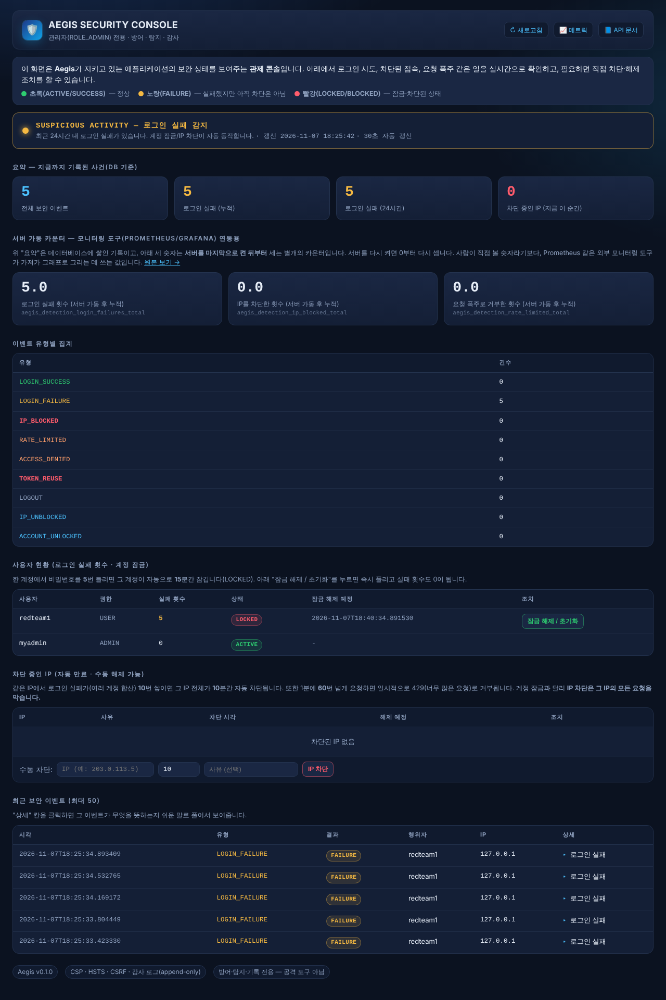
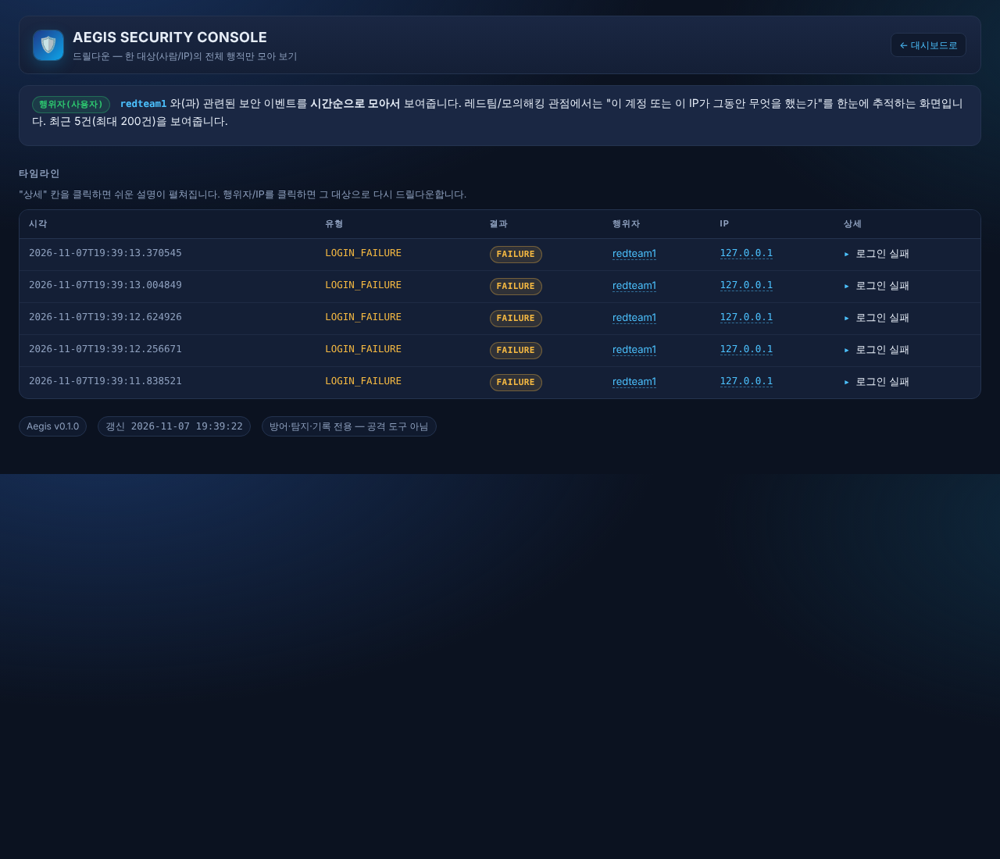

# Aegis 시연 문서 (면접·강사 상담용)

5분 안에 "무엇을 만들었고, 왜 안전한지, 실제로 뚫어도 막히는지"를 보여주기 위한 문서입니다.
화면 캡처와 함께 그대로 따라 말하면 되는 **발표 대본**을 겸합니다.

## 한 줄 소개
> "Aegis는 제가 처음부터 설계·구현한 방어형 웹 보안 시스템입니다. 인증, 무차별 대입 탐지, IP 자동
> 차단, 레이트리밋, 감사 로그, 관리자 콘솔까지 전부 직접 만들었고, 제가 직접 Burp Suite로 공격해
> 방어가 실제로 작동하는지도 검증했습니다."

## 1. 관제 콘솔 — 한눈에 보는 보안 상태



- 위쪽 **위협 수준 배너**는 지금 상태를 초록/노랑/빨강으로 즉시 보여줍니다.
- **요약**은 DB에 쌓인 영구 기록, **서버 가동 카운터**는 Prometheus/Grafana 같은 외부 모니터링
  도구가 가져가는 실시간 누적 수치입니다 — 이 둘을 분리한 이유까지 설명하면 설계 의도를 더 잘
  전달할 수 있습니다.
- 맨 위 "빠른 이동" 버튼으로 긴 화면을 섹션별로 바로 이동할 수 있습니다.

## 2. 드릴다운 — "이 사람/이 IP가 뭘 했나" 추적



- 사용자 현황·차단 IP·최근 이벤트 표의 **이름·IP를 클릭**하면, 그 대상과 관련된 사건만 시간순으로
  모아 보여주는 화면으로 이동합니다.
- 레드팀/모의해킹 관점에서 말하면: "공격자(또는 공격받은 계정) 한 명의 행적만 추려서 보는 기능을
  직접 설계해 추가했습니다."

## 3. 방어 기능이 실제로 작동하는지 시연하는 순서

### 준비
```bash
bash gradlew bootRun
```
브라우저에서 `http://localhost:8080/swagger-ui.html`(기능을 클릭으로 실행하는 화면)과
`http://localhost:8080/admin/dashboard`(관제 콘솔)을 각각 탭으로 엽니다.

### 시연 1 — 정상 흐름
1. `POST /api/auth/signup`으로 계정 가입 → `201`
2. `POST /api/auth/login`으로 로그인 → `200`, 토큰 발급

### 시연 2 — 무차별 대입 방어 (계정 잠금)
같은 계정에 틀린 비밀번호를 5번 보내면:
- 1~5번째: `401`
- 6번째: **`423 Locked`**

대시보드로 돌아가 새로고침 → 배너가 노란색으로 바뀌고, 그 계정이 **LOCKED**로 표시됩니다.
실제 Burp Suite로 재현한 증거는 [PENTEST_REPORT.md](PENTEST_REPORT.md) 3절 참고.

### 시연 3 — IP 자동 차단
여러 계정에 걸쳐 로그인 실패가 IP 기준 10회를 넘으면, 그 컴퓨터(IP) 자체가 10분간 **`403`**으로
차단됩니다. 계정이 아니라 **네트워크 단위**로 막힌다는 점이 핵심입니다.

### 시연 4 — 관리자 조치
대시보드에서 잠긴 계정의 "잠금 해제 / 초기화", 차단된 IP의 "차단 해제"를 클릭해 즉시 조치할 수
있습니다. 조치 내역도 전부 감사 로그에 남습니다(`ACCOUNT_UNLOCKED`, `IP_UNBLOCKED`).

### 시연 5 — 입력 검증
```json
{"username":"a<script>","password":"1234"}
```
→ `400`으로 즉시 거부(아이디 형식·비밀번호 길이 검증). `"role":"ADMIN"` 같은 모르는 필드를 끼워
넣어도 `400`으로 거부되어 권한 상승을 막습니다.

## 4. 예상 질문과 답변 포인트

**Q. 왜 Spring Boot/Java로 만들었나요?**
A. 실무에서 가장 널리 쓰이는 스택 중 하나이고, Spring Security가 인증/인가/CSRF/보안 헤더를
표준화된 방식으로 제공해 "스스로 암호화 로직을 짜는" 실수를 줄일 수 있었습니다.

**Q. SQL 인젝션은 어떻게 막았나요?**
A. 문자열을 직접 이어붙이는 쿼리를 아예 쓰지 않고, 전 구간 JPA(파라미터 바인딩)만 사용했습니다.
`PENTEST_REPORT.md`에도 이 부분을 직접 공격해 검증한 결과를 적어 두었습니다(후속 테스트 예정 포함).

**Q. 왜 IP 차단과 계정 잠금을 따로 만들었나요?**
A. 계정 하나만 공격당했을 때 같은 IP를 쓰는 다른 정상 사용자까지 막아버리지 않기 위해서입니다.
계정 잠금이 1차 방어, IP 차단이 2차(더 강한) 방어입니다.

**Q. 테스트는 어떻게 검증했나요?**
A. 자동 테스트 62개(JUnit + MockMvc)로 모든 보안 로직을 커버했고, 그 위에 Burp Suite로 실제
공격을 재현해 두 방어 메커니즘이 실제로 작동하는 것을 눈으로 확인했습니다. 그 과정에서 IPv4/IPv6
이중 스택으로 인한 우회 가능성도 추가로 발견해 보고서에 남겼습니다.

**Q. 아쉬운 점이나 한계는요?**
A. 2단계 인증(2FA), 분산 환경(Redis 기반 레이트리밋)은 아직 없습니다. 또한 IP 차단이 문자열을
그대로 비교해서, IPv4/IPv6 주소를 정규화하지 않으면 우회될 수 있다는 걸 테스트 중 직접 발견했고
보고서에 권고사항으로 적어 두었습니다.

## 관련 문서
- 전체 기능/쓰는 법: [../README.md](../README.md)
- 실제 공격 테스트 보고서: [PENTEST_REPORT.md](PENTEST_REPORT.md)
- 설치→실행→사용 설명서: [MANUAL.md](MANUAL.md)
