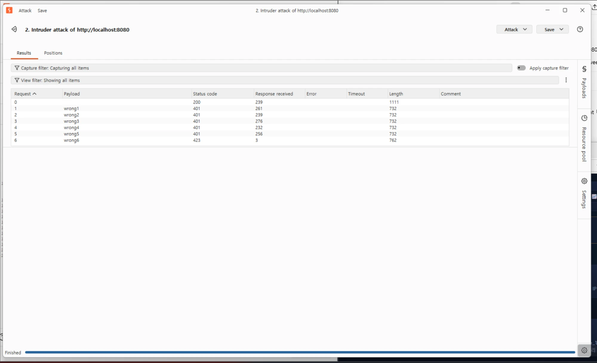
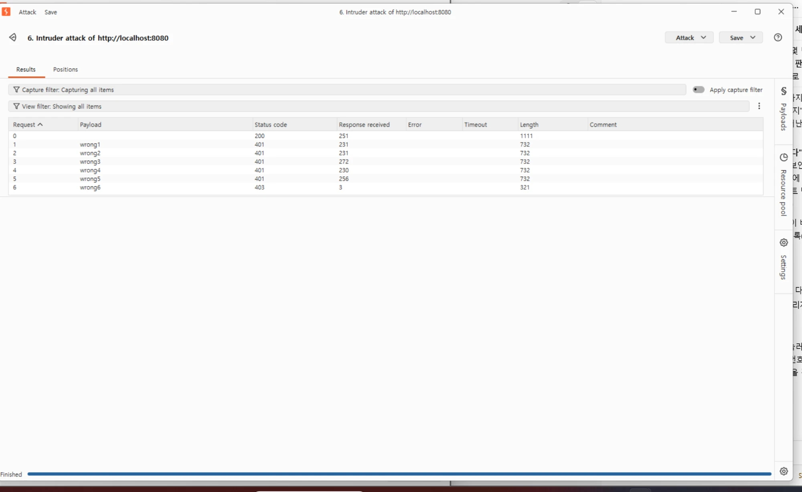
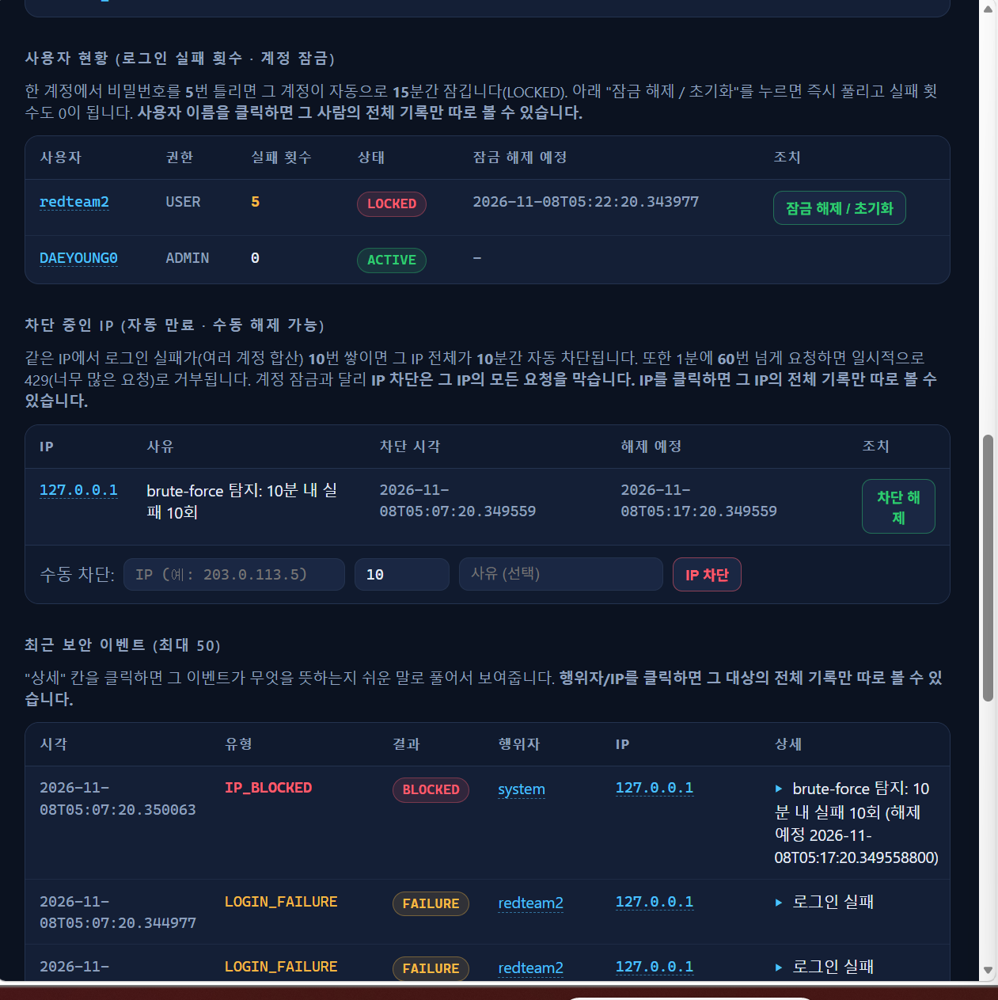
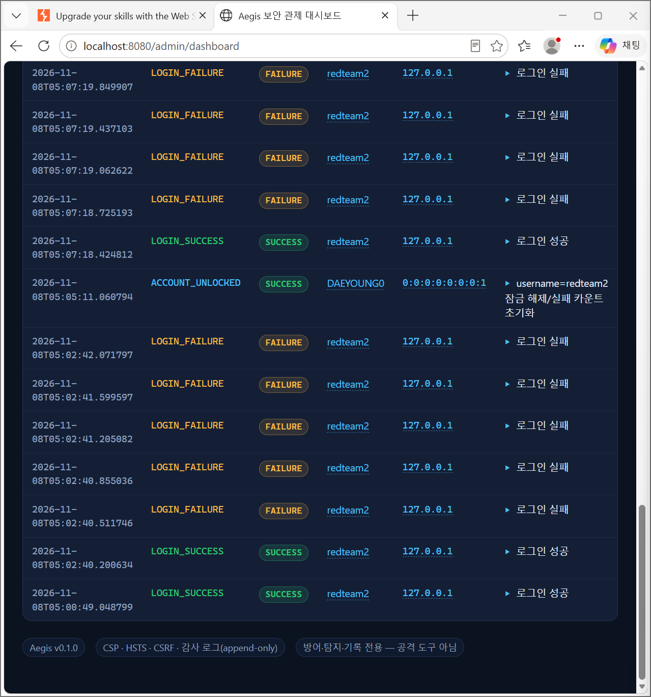

# Aegis 모의해킹 테스트 보고서 (Penetration Test Report)

> 이 문서는 포트폴리오/학습용으로 작성된 **자체 소유 시스템에 대한 모의해킹 보고서**입니다.
> 대상은 전부 테스터 본인이 만든 Aegis 서버(`http://localhost:8080`, 외부 비공개)이며,
> 공개된 제3자 서비스는 전혀 포함되지 않습니다.

## 1. 개요

| 항목 | 내용 |
|---|---|
| 대상 시스템 | Aegis (방어형 웹 보안 애플리케이션) — [GitHub](https://github.com/zaqxsw108091-create/aegis) |
| 테스트 환경 | `http://localhost:8080` (테스터 본인 노트북, 외부 비공개) |
| 승인/범위 | 테스터가 직접 소유·운영하는 로컬 서버. 제3자 시스템은 포함되지 않음 |
| 사용 도구 | Burp Suite Community Edition v2026.10.1 (Proxy, Intruder) |
| 테스트 기법 | 무차별 대입(Brute Force) — OWASP Top 10 A07:2021 (식별 및 인증 실패) |
| 목적 | Aegis가 구현한 방어 메커니즘(계정 잠금, IP 자동 차단)이 실제로 공격을 막는지 검증 |

## 2. 방법론

1. Burp Suite 내장 브라우저로 Swagger UI(`/swagger-ui.html`)에 접속해 테스트 계정을 가입시킨다.
2. 그 계정으로 정상 로그인 요청(`POST /api/auth/login`)을 한 번 보내, Burp Proxy가 그 요청을
   가로채도록 한다(HTTP history).
3. 그 요청을 **Intruder**로 보내고, 비밀번호 필드를 공격 지점(`§ §`)으로 지정한다.
4. 공격 지점에 틀린 비밀번호 6개(`wrong1`~`wrong6`)를 Payload(Simple list)로 등록한다.
5. **Sniper 공격**을 실행해 각 요청의 HTTP 상태 코드를 관찰한다.
6. 결과를 Aegis 관제 콘솔(`/admin/dashboard`)에서 교차 확인한다.

## 3. 테스트 1 — 계정 단위 무차별 대입 → 계정 잠금(423)

### 절차 및 증거
- 대상 엔드포인트: `POST /api/auth/login`
- 테스트 계정: `redteam1` (`username`/`password` 가입)
- Payload 위치: JSON 본문의 `password` 필드
- Payload: `wrong1`, `wrong2`, `wrong3`, `wrong4`, `wrong5`, `wrong6`

| # | Payload | 응답 상태 코드 |
|---|---|---|
| 0 | (맞는 비밀번호, 기준값) | `200 OK` |
| 1 | `wrong1` | `401 Unauthorized` |
| 2 | `wrong2` | `401 Unauthorized` |
| 3 | `wrong3` | `401 Unauthorized` |
| 4 | `wrong4` | `401 Unauthorized` |
| 5 | `wrong5` | `401 Unauthorized` |
| 6 | `wrong6` | **`423 Locked`** |



### 분석
5번째 실패(`count == 5`)에서 계정의 `lockedUntil`이 `now + 15분`으로 설정되고(`LoginAttemptService.onFailure`),
6번째 요청부터는 비밀번호 검증 자체를 하지 않고 `423`으로 즉시 거부한다. 잠긴 동안에는 **맞는 비밀번호를
넣어도 통과되지 않음**을 별도로 확인했다(재현 테스트에서 baseline 요청도 `423`으로 응답).

### 결론
무차별 대입 공격은 **5회 만에 자동으로 차단**되며, 공격자가 올바른 비밀번호를 포함해 더 이상 시도할 수
없다. **방어 정상 동작(Pass).**

## 4. 테스트 2 — IP 단위 누적 실패 → IP 자동 차단(403)

### 절차 및 증거
같은 세션에서 여러 계정(`redteam1`, `redteam2` 등)에 대해 반복적으로 로그인 실패를 발생시킨 결과,
**같은 IP(`127.0.0.1`)에서 누적된 로그인 실패가 10회를 넘는 순간** 계정 단위 잠금(423)이 아니라
**IP 전체 차단(403)**이 먼저 발동했다.

| # | Payload | 응답 상태 코드 |
|---|---|---|
| 0 | (맞는 비밀번호, 기준값) | `200 OK` |
| 1~5 | `wrong1`~`wrong5` | `401 Unauthorized` |
| 6 | `wrong6` | **`403 Forbidden`**(계정이 아니라 IP 차단) |



관제 콘솔에서 확인한 차단 기록(행위자 `system` = 자동 탐지, 사유 "brute-force 탐지: 10분 내 실패 10회"):



### 분석
`BruteForceProtectionService`는 **10분 창 내 같은 IP의 실패 횟수**(여러 계정 합산)를 집계하다가
임계치(10회)를 넘으면 그 IP를 10분간 전역 차단한다. 이 차단은 계정 잠금보다 **상위 레벨**에서
작동하여(`IpBlockFilter`가 가장 먼저 요청을 가로챔), 차단된 IP는 올바른 비밀번호를 가진 요청이든,
존재하지 않는 계정에 대한 요청이든 전부 `403`으로 즉시 거부된다.

### 결론
개별 계정 잠금을 우회하려고 여러 계정을 돌려가며 공격해도, **IP 단위 전역 방어가 추가로 작동**한다.
**방어 정상 동작(Pass).**

## 5. 추가 발견 — IPv4/IPv6 이중 스택으로 인한 IP 차단 우회 가능성 (Finding)

### 발견 내용
IP 차단은 **문자열이 정확히 일치하는 IP만** 차단한다. 테스트 중 다음이 확인됐다.

- Burp Suite(공격 트래픽)는 `localhost`를 **IPv4** `127.0.0.1`로 접속 → 이 주소가 차단됨
- 같은 컴퓨터의 브라우저(관리자 세션)는 같은 `localhost`를 **IPv6** `0:0:0:0:0:0:0:1`(`::1`)로
  접속 → 차단 테이블에 없는 "다른 문자열"이라 **차단이 적용되지 않음**

즉 `127.0.0.1`이 차단된 상태에서도, **같은 물리적 호스트가 IPv6 경로로 접속하면 모든 보호(IP 차단,
IP 단위 집계)를 그대로 통과**했다.



### 영향
- **위험도: 중간(Medium).** 공격자가 두 경로(IPv4/IPv6)를 번갈아 사용하면, 한쪽이 차단돼도 다른
  쪽 경로로 시도 횟수를 계속 쌓아 사실상 **차단을 우회**할 수 있다.
- 다만 계정 단위 잠금(테스트 1)은 IP와 무관하게 독립적으로 동작하므로, 이 우회로도 **개별 계정
  자체는 여전히 보호**된다. 영향은 "IP 기반 집계/차단"에 한정된다.

### 권고(Remediation)
1. 요청의 원격 주소를 저장/비교하기 전에 **정규화(canonicalize)**한다. IPv4-매핑 IPv6 주소
   (`::ffff:127.0.0.1`)와 루프백 별칭(`::1` ↔ `127.0.0.1`)을 동일 주소로 취급하도록 통일한다.
2. 운영 환경에서는 애플리케이션을 리버스 프록시 뒤에 두고, 신뢰할 수 있는 `X-Forwarded-For`만
   사용하도록 강제한다(이미 `server.forward-headers-strategy=framework`가 prod 프로파일에 적용돼
   있으나, 신뢰 프록시 목록 제한은 별도 점검이 필요).
3. 가능하면 서버 바인딩을 IPv4/IPv6 중 하나로 고정하거나, 듀얼스택 환경에서는 집계 키를
   "정규화된 주소" 기준으로 한 번 더 감사한다.

## 6. 종합 결론

| # | 테스트 | 결과 |
|---|---|---|
| 1 | 계정 단위 무차별 대입 방어(계정 잠금) | ✅ Pass |
| 2 | IP 단위 누적 실패 방어(IP 자동 차단) | ✅ Pass |
| 3 | IP 차단의 IPv4/IPv6 정규화 | ⚠️ Finding (Medium) — 권고 사항 있음 |

Aegis의 핵심 방어 로직(계정 잠금, IP 자동 차단)은 설계된 대로 정확히 작동했다. 다만 실제 공격·방어를
반복 테스트하는 과정에서, **문서화되지 않았던 IP 정규화 관련 우회 가능성**을 추가로 발견했다. 이는
기능 결함이 아니라 **운영 환경에서 반드시 검토해야 할 설정 포인트**이며, 이번 테스트의 실질적인
부가 가치다.

## 7. 재현 방법

이 보고서의 테스트는 Aegis 저장소의 [docs/TEST_GUIDE.md](TEST_GUIDE.md) 환경에서 누구나 동일하게
재현할 수 있다. 요약:

```bash
# 1) 서버 기동
bash gradlew bootRun

# 2) 테스트 계정 가입 (Swagger UI 또는 curl)
curl -s -H "Content-Type: application/json" -X POST localhost:8080/api/auth/signup \
  -d '{"username":"redteam1","password":"RedTeam2026pw"}'

# 3) Burp Suite로 /api/auth/login 요청을 가로채 Intruder에 전달,
#    password 자리에 wrong1~wrong6 Payload로 Sniper 공격 실행
```

---
*이 보고서는 학습·포트폴리오 목적의 자체 점검 결과이며, 실제 상용 서비스에 대한 공식 모의해킹
계약 보고서가 아닙니다.*
